# Defense-Aware Autoencoder (DAAE)

Defense-Aware Autoencoder (DAAE) is a research framework that evaluates the robustness of website fingerprinting (WF) defenses. Many defenses inject **dummy packets** (padding, cover traffic) to obfuscate deep-learning WF classifiers. DAAE learns to **reverse** those perturbations using a small paired subset of original and defended traces, then recovers the remaining defended traces to improve WF attack accuracy.

:warning: :warning: :warning: This software is a research prototype intended solely for experimental and evaluation purposes. :warning: :warning: :warning:

## Auto–Decoder for Traffic Recovery

Auto–decoder models compress input into a latent space and reconstruct outputs:
  1. Encodes defended traces into latent representations.
  2. Predicts a **dummy-packet mask** (which positions are injected).
  3. Reconstructs original packet values at non-dummy positions.

With only **20–30%** paired traces per class for training, DAAE generalizes to recover all other instances—demonstrating that defense perturbations can be learned and reversed


## Project Structure

```
DAAE/
├── README.md
├── requirements.txt
├── DAAE.md                  # Detailed design and evaluation for the DAAE attack
└── daae/
    ├── config.py           # Hyperparameters only (no dataset paths)
    ├── cli.py              # Shared --original-root/--defended-root/--output-dir args
    ├── train.py            # Train FS-DAAE
    ├── recover.py          # Remove dummy packets from defended traces
    ├── evaluate.py         # Recovery + WF attack evaluation
    ├── data/
    │   ├── cell_io.py      # .cell file parser
    │   ├── features.py     # Defense-agnostic multi-channel features
    │   ├── alignment.py    # Direction-based dummy mask labels
    │   ├── few_shot.py     # Episodic K-shot support sampling
    │   ├── support_bank.py # Per-class support memory for inference
    │   └── dataset.py      # Per-class train/val/test split
    └── models/
        ├── daae.py         # Baseline Defense-Aware Autoencoder
        ├── fs_daae.py      # Few-Shot DAAE with support-query attention
        ├── losses.py       # Focal BCE + reconstruction loss
        ├── factory.py      # Model creation/checkpoint loading
        └── classifier.py   # 1D-CNN WF attack model
```

## Installation

```bash
pip install -r requirements.txt
```

## Usage

All commands require these arguments:

| Argument | Description |
|----------|-------------|
| `--original-root` | Original (undefended) `.cell` directory |
| `--defended-root` | Defended `.cell` directory (same filenames) |
| `--output-dir` | Output directory for checkpoints and results |
| `--num-classes` | Number of classes to load (`0` .. `num_classes-1`) |
| `--num-instances` | Number of instances per class (`0` .. `num_instances-1`) |
| `--train-ratio` | Fraction of per-class instances used for DAAE training |

Dataset discovery constructs paths directly as `{class}-{instance}.cell` (fast) instead of scanning the full directory.

## GPU / high-memory server (RTX PRO 6000, 192GB RAM)

Defaults are tuned for this hardware:

- **Batch size 128** (increase with `--batch-size 256` if VRAM allows)
- **Mixed precision (AMP)** on CUDA
- **GPU-resident tensors** — train/val data loaded directly to GPU (zero H2D copy per epoch)
- **Preload train + val** into RAM/GPU with disk cache under `{output_dir}/.daae_cache/`
- **32 parallel preload workers** for first-time cache build
- **`torch.compile`** enabled by default (disable with `--no-compile` if needed)

### Model training

```bash
python -u -m daae.train \
  --original-root ../DF/CW \
  --defended-root ../defense/palette/CW/DF \
  --output-dir ./results/palette-daae \
  --num-classes 95 --num-instances 1000 \
  --trace-format paired_dir \
  --train-ratio 0.3 \
  --max-len 10000 \
  --epochs 50 --batch-size 3
```

### Defended dataset recovery

```
python -u -m daae.recover \
  --checkpoint ./results/palette-daae/daae_best.pt \
  --defended-root /data/dataset/newDataset/defenses/palette/CW/DF \
  --output-dir ./results/palette-daae \
  --num-classes 100 --num-instances 2000
```

---------------------------------------------------------------------------------------

# DAAE: Defense-Aware Website Fingerprinting via Learning Defense-Induced Traffic Transformations

## 1. Introduction

The Tor network [10] employs layered encryption and multi-hop routing through a sequence of relays to protect users’ identities and browsing activities. Despite these anonymity mechanisms, website fingerprinting (WF) attacks [2, 3, 32, 35] remain a persistent threat to Tor users’ privacy. WF attacks exploit traffic characteristics that remain observable even when application-layer contents are encrypted, enabling an adversary to infer the websites visited by a user. In particular, encrypted Tor traffic retains side-channel information
such as packet timing [9, 20, 40, 42], burst patterns [2, 45], and packet directions [3, 30]. By learning distinctive patterns in these features, an adversary can associate an observed traffic trace with a candidate website without directly accessing the user’s encrypted content.

Deep learning (DL) techniques have significantly enhanced the effectiveness of WF attacks [3, 16, 30, 32, 35]. These approaches can automatically learn distinctive patterns from encrypted traffic traces and achieve high classification performance under various experimental settings. This progress has consequently motivated extensive research on defenses against WF attacks [4, 18, 43]. Existing defenses generally aim to disrupt the traffic characteristics exploited by WF classifiers. For example, adaptive padding-based techniques [11, 18, 27] obscure timing and burst information by adaptively or randomly injecting dummy packets. Adversarial perturbation techniques [21, 28, 39, 44] instead construct carefully designed perturbations that alter traffic traces in ways intended to mislead DL-based WF classifiers. Regularization-based approaches [13, 40, 43] transform traffic into more regular transmission patterns, reducing the distinguishability of traces associated with different websites.

Recently, adversarial training (AT)-enhanced WF attacks [6, 25] have been introduced to defend against the previously proposed defense mechanisms [28, 29]. However, the state-of-the-art (SOTA) defense methods [13, 19, 33] have proven to be strong at defending against AT-enhanced WF attacks. For instance, Regulator [13] regularizes the size and shape of packet 'surges' that frequently occur in download traffic, masking potentially revealing features. In this paper, 'surge' is broadly defined as a large number of packets sent over a short period of time. Palette [33] first clusters website traffic traces with high-similarity traffic patterns offline and then applies traffic regularization online to enforce real-time traces into a uniform traffic pattern. Considering that the Palette is limited to its predefined dataset for clustering [19]. Adaptive Tamaraw [19] proposes an adaptive WF defense framework with dynamic clustering to adjust defense parameters in real time.

To undermine the effectiveness of WF defenses that are robust against AT-based attacks, we analyze existing defense mechanisms and find that most induce stable, learnable mappings in traffic patterns, which can be exploited by defense-aware attacks. We utilize the mapping method to functionalize the relationship between the undefended Tor traffic traces and the defended Tor traffic traces. We found that the existing defense mechanisms usually perform a one-to-one mapping [11, 28, 44] or many-to-one mapping [13, 19, 33]. Through analyzing the mapping strategy, we consider introducing an advanced WF attack mechanism that enhances the WF attack performance. Specifically, we assume a strong WF adversary who is aware that a defense is deployed on Tor but does not know the specific defense mechanism being used (black-box). The adversary can train a Defense-Aware Autoencoder (DAAE) model to learn defense-induced perturbation patterns using paired original Tor website traces and defense-perturbed traces. Then, use the trained model to mark and remove potential injected dummy packets from defense traces.

In this paper, we propose DAAE, a novel framework for removing dummy packets from defense traces. Specifically, DAAE first employs longest common subsequence (LCS) alignment on paired defended and undefended traces to generate an LCS Keep Mask, which labels each packet as either an original packet (marked as 1) or a dummy packet (marked as 0). The extracted LCS packet sequences are also stored in an LCS Bank, which serves as a class-specific feature repository. Next, the LCS Bank and the corresponding LCS Keep Masks are used to train a few-shot-based DAAE model, FS-DAAE, which consists of a one-dimensional U-Net decoder and a four-stage encoder built from stride-2 one-dimensional convolutional (Conv1D) layers. Once trained, FS-DAAE generates mask logits for previously unseen defended traces, enabling the identification and removal of dummy packets. The resulting recovered traces are then fed into deep learning-based WF attack models, including DF [35], Var-CNN [3], and NetCLR [2], to improve attack effectiveness. Specifically, our work addresses the following two challenges.

*First, how can we achieve robust and effective WF attacks across diverse defense mechanisms, and how can we learn defense-induced packet injection patterns without access to the internal implementations of WF defenses?* Existing WF defenses employ diverse strategies, including traffic obfuscation [23, 33], traffic regularization [4, 13], adversarial perturbation [14, 36], and website morphing [1, 5, 22]. Our analysis reveals that these defenses induce learnable mappings between undefended and defended Tor traffic traces, typically exhibiting one-to-one [11, 28, 44] or many-to-one [13, 19, 33] relationships. To exploit these mappings, we design a Defense-Aware Autoencoder (DAAE) that learns to distinguish original packets from defense-injected dummy packets. Specifically, we first align paired undefended and defended traces using longest common subsequence (LCS) matching to construct packet-level masks, where original and dummy packets are labeled as 1 and 0, respectively. We then store the aligned packet sequences in a class-specific LCS Bank and use the sequences and masks to train a few-shot DAAE model (FS-DAAE), comprising a stride-2 Conv1D encoder and a one-dimensional U-Net decoder. Given a previously unseen defended trace, FS-DAAE predicts a packet-level mask to identify and remove dummy packets, allowing existing WF classifiers to operate on the recovered traces. This approach enables defense-aware attacks without requiring access to the defense implementation.

*Second, how can we accurately identify and remove dummy packets while preserving original packets?* Since dummy packets are interleaved with original packets and may exhibit similar direction patterns, packet-level classification can mistakenly remove original packets or retain dummy packets, compromising trace recovery and subsequent WF attacks. To address this challenge, DAAE leverages longest common subsequence (LCS) alignment between paired defended and undefended traces to generate packet-level keep masks, providing supervision for distinguishing original packets from injected dummy packets. We store the aligned sequences in a persistent, class-specific LCS Bank and train FS-DAAE to combine support-trace features with query-trace representations through support-query fusion, feature-wise linear modulation, and cross-attention. The U-Net decoder then produces packet-level keep logits for each defended query. During inference, rather than independently thresholding these logits, DAAE employs insertion-only Viterbi decoding to find a high-scoring keep mask under the constraint that the original trace must be a subsequence of the defended trace. Finally, it retains the selected packets in their original order and removes the rest, without accessing the query's original trace or any validation/test samples during recovery.

Our evaluation across two widely used datasets and seven state-of-the-art (SOTA) WF defenses demonstrates that DAAE substantially improves attack effectiveness, particularly against defenses designed to resist adversarial training (AT)-based attacks. On the DF dataset, DAAE achieves classification accuracies of up to 97.85\%, 98.47\%, and 97.83\% for DF, Var-CNN, and NetCLR, respectively. On the GTT23 dataset, DAAE achieves accuracies of up to 86.03\%, 83.65\%, and 86.31\% for the three attack models, respectively. Notably, against RegulaTor, Palette, and Adaptive Tamaraw, DAAE consistently outperforms both attacks without AT and attacks with AT, demonstrating its effectiveness in recovering discriminative traffic patterns under challenging defense settings.

 - We analyze existing WF defense mechanisms and identify stable, learnable mappings between defended and undefended traffic traces. Our findings reveal that these mappings can be exploited by defense-aware attacks, even against defenses designed to resist AT-based WF attacks.
 - We propose DAAE, a novel framework that combines LCS alignment and an FS-DAAE model to identify and remove dummy packets from defended traces. By leveraging class-specific packet sequence features and learned packet masks, DAAE aims to recover the underlying traffic patterns while reducing the need for extensive unlabeled traces.
 - We conduct a comprehensive evaluation of DAAE on two widely used public datasets and against seven SOTA defense mechanisms, demonstrating its effectiveness in removing dummy packets and improving WF attack performance across diverse defense settings.

## 2. Threat Model and Problem Statement

### 2.1 Threat Model


Figure 1: Overview of the Tor network and Threat Model. 

*Attack Scenario*： We consider the standard local passive adversary that monitors the communication network traffic between the Tor client and the entry guard but cannot modify traffic packets. As shown in Figure 1, potential adversaries include eavesdroppers on the client's local network, Internet service providers (ISPs), autonomous systems (ASes), and malicious Tor guard nodes. Although Tor encrypts traffic contents, these adversaries can observe traffic characteristics that may reveal information about the websites visited by the client.
To defend against WF attacks, a WF defense can be deployed through a pluggable transport (PT) bridge [12, 33, 44], which operates between the Tor client and the entry guard and transforms observable traffic patterns before they traverse the monitored network path.

*Attacker Capability*: We consider a strong adversary with access to defended traffic traces from monitored webpages collected under conditions comparable to those experienced by a normal user. We assume that the adversary can operate as a Tor user and collect both the original Tor traffic at the client side (① in Figure 1) and the corresponding defended traffic transmitted through the PT client and PT server (② in Figure 1). Additionally, the adversary can passively capture the victim's network traffic between the victim's device and the entry guard. Using the captured network traffic traces, the adversary can train WF classifiers under two attack strategies: *adversarial training*-based WF attacks and *DAAE*-based WF attacks. The former incorporates defended traffic into the training process to improve classification performance against the deployed defense, while the latter leverages a *DAAE*-based approach to learn the dummy packet injection mechanism without knowledge of the defense algorithm, thereby facilitating website identification despite traffic transformations. By considering both strategies, we evaluate the effectiveness of*DAAE*-based WF attacks against WF defenses in the presence of defense-induced changes in traffic patterns.

*Attacker Knowledge*: The *DAAE* does not require prior knowledge of the destination webpage. Thus, *DAAE* can be applied to arbitrary browsing webpages rather than a pre-configured set of static candidate traces. Additionally, PTs are independently deployed by users. Therefore, the defense for different users does not rely on the same predefined payloads or destination-specific configurations. In this setting, *DAAE* can avoid introducing stable, webpage-dependent artifacts that an adaptive adversary can learn.

*Closed- and Open-World Scenarios*: WF attacks are commonly evaluated under closed-world and open-world scenarios [2, 8, 27, 34, 41]. In the closed-world scenario, the client is assumed to visit only a predefined set of websites, referred to as monitored websites. The attacker has access to traffic traces collected from these websites and uses them to train a classifier to identify which monitored website the client visits. In contrast, the open-world scenario reflects a more realistic setting in which the client may visit either monitored websites or a much larger set of unmonitored websites. Since the attacker can obtain training traces for a subset of unmonitored websites, the goal is to determine whether the client's traffic corresponds to one of the monitored websites.

### 2.2 Problem Formulation

Tor network traffic can be represented as a time-ordered sequence of packets. Since packet timing is sensitive to network conditions and user location, we focus exclusively on packet directions in this work. Formally, each traffic trace corresponding to the loading of a webpage is represented as:

$$
w = [d_1, d_2, \ldots, d_N]
$$

Here, $N$ is the total number of website packets observed during the session. $d_i \in \{+1, -1\}$ denotes the direction of the $i$-th packet. In particular, $+1$ denotes an outgoing packet, and $-1$ denotes an incoming packet.

Let $\mathcal{W}$ denote the monitored websites and $\mathcal{X}$ denote the space of observable traffic. An adversary aims to learn a classification model:

$$
h: \mathcal{X} \rightarrow \mathcal{W}
$$

that predicts the specific website from an observed trace. The WF defense system can be regarded as a stochastic transformation mechanism:

$$
\mathcal{D}: \mathcal{X}' \rightarrow \mathcal{D}(\mathcal{X})
$$

where $\mathcal{D}(\mathcal{X})$ denotes a distribution over defended traces.

$\mathcal{R} \subseteq \mathcal{X} \times \mathcal{X}'$ denotes the defense relation, where $(w, w') \in \mathcal{R}$ indicates that $w'$ is a valid defended trace generated from the original trace $w$ by the defense mechanism. A WF defense mechanism usually modifies $w$ to $w'$ by injecting dummy packets $d_i'$, where $i$ denotes the dummy packet's insertion position in the trace.

In this work, we propose $\mathcal{D}$, a deep learning-based approach that learns defense-induced traffic transformation patterns from paired original and defended Tor traffic traces. Given a training dataset:

$$
\mathcal{S}_{\mathrm{train}} = \{(w_i, w_i')\}_{i=1}^{M}
$$

where each $w_i$ is an original trace and $w_i'$ is its corresponding defended trace, the model learns to identify the injected dummy packets and recover the original packet-direction sequence.

After training, the model is applied to previously unseen defended traces to remove injected dummy packets and reconstruct the underlying original traffic. Formally, the recovery process is defined as:

$$
\hat{w} = \mathcal{G}(w')
$$

where $\mathcal{G}$ denotes the trained recovery model, and $\hat{w}$ is the recovered trace approximating the original trace $w$. The objective is to minimize the discrepancy between the recovered trace $\hat{w}$ and its original counterpart $w$, enabling the model to recover original traffic patterns from defended observations.

Since $w$ and $w'$ are sequences of packet directions, and the defense mechanism preserves the original packets while inserting dummy packets, the original trace $w$ is a subsequence of the defended trace $w'$, denoted by:

$$
w \preceq w'
$$

Accordingly, the recovery model aims to identify and remove the injected dummy packets from $w'$ to reconstruct the original trace $w$.

### 2.3 Notation and Definitions

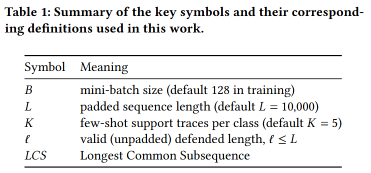

Table 1 summarizes the key symbols and terminology used throughout this work. $B$ denotes the mini-batch size used during model training, which is set to 128 by default. $L$ represents the padded sequence length, with a default value of 10,000, ensuring that traffic traces can be processed in a consistent input format. $K$ denotes the number of support traces per class in the few-shot learning setting, which is set to 5 by default. The variable $\ell$ represents the actual length of a defended traffic trace before padding, satisfying $\ell \leq L$. Finally, $LCS$ stands for Longest Common Subsequence, a measure used to identify the longest sequence of elements shared by two sequences while preserving their relative order.

## 3. System Design


Figure 2: An overview of the DAAE architecture.

In this section, we demonstrate the design details of the DAAE. As shown in Figure 2, the proposed DAAE comprises three key phases: the dataset pre-processing phase, the few-shot-based DAAE (FS-DAAE) model training phase, and the defended trace recovery phase.

### 3.1 Dataset Pre-processing

In this work, the proposed $\mathcal{D}$ aims to learn the dummy packet injection patterns of existing WF defense mechanisms by training a deep learning model on a small number of paired original and defended Tor traces. Considering that some defense mechanisms can double or even triple the length of a trace, we set the trace length to $L=10000$ to accommodate the additional packets introduced by these defenses.

Let $\mathbf{x}^{\mathrm{ori}}=[d^{\mathrm{ori}}_1,\ldots,d^{\mathrm{ori}}_n]$ and $\mathbf{x}^{\mathrm{def}}=[d^{\mathrm{def}}_1,\ldots,d^{\mathrm{def}}_m]$ denote the direction sequences of the original and defended traces, respectively, where each direction is represented by an element of $\{\pm 1\}$ and $m \geq n$ in the typical case. Since the insertion of dummy packets shifts the positions of subsequent original packets, the two traces can no longer be aligned directly by packet index.

To address this issue, DAAE formulates dummy packet identification as an **insertion-only sequence alignment problem** and employs the longest common subsequence (LCS) algorithm to align the two direction sequences. The LCS is computed using the following dynamic programming recurrence:

$$
\mathrm{LCS}[i,j] =
\begin{cases}
0, & \text{if } i=0 \text{ or } j=0,\\
\mathrm{LCS}[i-1,j-1]+1,
& \text{if } d^{\mathrm{ori}}_i = d^{\mathrm{def}}_j,\\
\max\{\mathrm{LCS}[i-1,j],\,\mathrm{LCS}[i,j-1]\},
& \text{otherwise}.
\end{cases}
$$

By applying LCS-based alignment to each pair of original and defended traces, we can identify the positions of injected dummy packets in the defended trace. Based on the resulting alignment, we construct an **LCS-based keep mask** to label each packet in the defended trace: a value of 1 indicates that the packet corresponds to an original packet, whereas a value of 0 indicates that it is a dummy packet. The resulting keep masks serve as supervision labels for training the FS-DAAE model, enabling it to learn dummy packet injection patterns from a limited number of paired traces.

The support LCS bank maintains a persistent, class-conditioned memory of aligned defended traces and their LCS-derived keep masks, enabling defended trace recovery without requiring the original capture of a query trace. For each website class, it stores up to $K$ training instances and provides two complementary views: a few-shot support set for model training and a class-specific prototype for decoding. The prototype is constructed from the longest retained original-packet subsequence among the support instances, while the maximum keep ratio across these instances serves as a class-specific target for calibrating insertion-only Viterbi decoding. Unlike a conventional classifier memory that stores learned embeddings, the support LCS bank preserves representative defended traffic patterns and their packet-level original/dummy labels. The detailed FS-DAAE model training process will be introduced in the next section.

### 3.2 FS-DAAE Model Training

The proposed DAAE model is trained in a supervised few-shot setting (FS-DAAE) using paired original and defended Tor traces obtained during dataset preprocessing. Each training episode comprises a query trace and $K=5$ support traces sampled from the same website class, with the query excluded from support selection. Each pair is aligned using the LCS algorithm, providing packet-level supervision for distinguishing original packets from injected dummy packets.  This episodic formulation enables FS-DAAE to learn specific defense patterns across different visits without requiring the original trace of a query at inference time (defended trace recovery).

*FS-DAAE architecture.* FS-DAAE employs a one-dimensional U-Net and a four-stage stride-2 encoder. The four-stage stride-2 encoder progressively reduces the input sequence length from $L=10000$ to $L/16=625$, while increasing the feature channels from 1 to 512. The query and support traces share encoder weights. At the bottleneck, the LCS-derived support masks are embedded into the support features, which are aggregated to form a class-conditioned representation. Feature-wise linear modulation and eight-head cross-attention then incorporate support information into the query representation. A skip-connected decoder restores the sequence to its original resolution, incorporating an averaged support keep prior at the finest scale. A four-branch dilated mask head with dilation rates $\{1,2,4,8\}$ captures packet-retention patterns at multiple receptive-field scales. An auxiliary reconstruction head predicts packet directions, while a pooled latent representation is learned implicitly through the network. The primary output is a sequence of mask logits $\mathbf{z}\in\mathbb{R}^{B\times L}$, where $B$ is the batch size, and the reconstruction head produces $\hat{\mathbf{x}}\in\mathbb{R}^{B\times L}$.

*FS-DAAE Training Objective.* FS-DAAE is supervised by two signals derived from LCS alignment: a keep mask $\mathbf{M}$, where 1 indicates an original packet and 0 indicates a dummy packet, and a reconstruction target $\mathbf{x}^{\mathrm{target}}$ defined on the defended-trace timeline. At each matched position, the target contains the corresponding original packet direction. The unmatched dummy positions are assigned zero and excluded from reconstruction loss. A validity mask $V_{b,j}=\mathbb{1}[j<\ell_b]$, where $\ell_b$ is the valid length of query $b$, excludes padded positions from all loss terms.

The overall FS-DAAE training objective combines three loss groups comprising four complementary components: ℒ<sub>mask</sub>, ℒ<sub>recon</sub>, and ℒ<sub>len</sub>. The total objective is:

$$
ℒ = \lambda_{\mathrm{mask}}ℒ_{\mathrm{mask}} + ℒ_{\mathrm{recon}} + ℒ_{\mathrm{len}}
$$

where the default weight is $\lambda_{\mathrm{mask}}=2$. Specifically,

$$
ℒ_{\mathrm{mask}} = ℒ_{\mathrm{focal}} + \lambda_{\mathrm{dice}}ℒ_{\mathrm{dice}}
$$

where the default $\lambda_{\mathrm{dice}}$ is 0.5.

*Reconstruction loss ℒ<sub>recon</sub>:* Mean squared error is evaluated only on LCS-kept, unpadded defended positions. Dummy and pad indices are excluded from both the numerator and the denominator:

$$
ℒ_{\mathrm{recon}} =
\frac{
\sum_{b=1}^{B}\sum_{j=0}^{L-1}
V_{bj}M_{bj}
\left(\hat{x}_{bj}-x^{\mathrm{target}}_{bj}\right)^2
}{
\sum_{b=1}^{B}\sum_{j=0}^{L-1}
V_{bj}M_{bj}
}
$$

*Length loss ℒ<sub>len</sub>:* The predicted keep fraction is the mean of the *sigmoid probabilities* $p_{bj}$ over valid positions of each trace, not a count of thresholded decisions $\mathbb{1}[\sigma(z_{bj})\geq 0.5]$. With the time changed, the trace length will increase, so that:

$$
p^{\mathrm{t}}_{bj} = p_{bj} M_{bj} + (1-p_{bj})(1-M_{bj})
$$

For each $b$:

$$
\hat{r}_b =
\frac{\sum_{j=0}^{L-1} p_{bj} V_{bj}}
{\sum_{j=0}^{L-1} V_{bj}},
\qquad
r'_b =
\frac{\sum_{j=0}^{L-1} M_{bj} V_{bj}}
{\sum_{j=0}^{L-1} V_{bj}}
$$

The length term is the batch-mean $\ell_1$ gap between these soft rates:

$$
\mathcal{L}_{\mathrm{len}} =
\frac{1}{B}
\sum_{b=1}^{B}
\left|\hat{r}_b-r'_b\right|
$$

### 3.3 Defended Trace Recovery

The recovery phase reconstructs original traffic traces from defended-only observations, without requiring access to the query's original trace during inference. It uses the FS-DAAE checkpoint selected by the highest validation mask accuracy and the persistent support LCS bank constructed from the training split. For each defended capture, packet directions are extracted and truncated to a maximum sequence length $L=10000$, with the valid trace length recorded separately. All support information comes exclusively from training data, ensuring that recovery does not depend on the query's original trace or validation/test samples.

#### 3.3.1 FS-DAAE inference. 
The defended trace query will be passed through FS-DAAE in evaluation mode without gradient computation. The network applies the same support–query fusion used during training, including mask-conditioned support encoding, feature-wise linear modulation, cross-attention, and the U-Net decoder, to produce packet-level keep logits $\mathbf{z}\in\mathbb{R}^{ℒ}$. Although thresholding these logits at zero yields a straightforward binary keep mask, this strategy can retain isolated dummy packets or discard original packets. Therefore, the default recovery procedure uses insertion-only Viterbi decoding to exploit the structural constraint that the original direction sequence is a subsequence of the defended sequence.

#### 3.3.2 Trace Reconstruction.
Finally, DAAE retains the directions of all defended packets selected by the decoded keep mask, discarding the remaining packets and preserving their original order. Recovery is performed independently of evaluation: original traces are used only for subsequent assessment, not for generating the recovered output. In particular, the reported recovery results use the support-bank and insertion-decoding pipeline without oracle access to the query original. This design enables DAAE to remove dummy packets by combining learned packet-level evidence, specific defense patterns, and insertion-constrained sequence alignment.

## 4. Performance Evaluation

### 4.1 Implementation Details

Table 5: Parameter settings for evaluating DAAE.

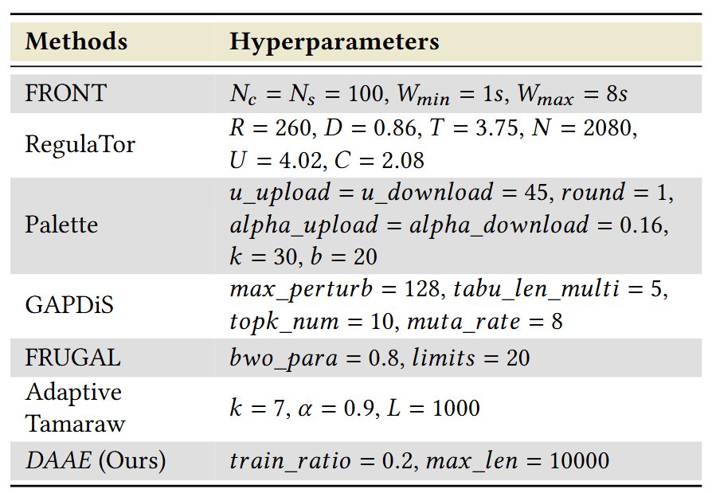

All experiments are conducted using PyTorch 2.8.0 and Python 3.10. To run and evaluate the performance of DAAE, training and evaluation were performed on a system equipped with an NVIDIA RTX PRO 6000 GPU (96 GB VRAM), an Intel Ultra 9 285K CPU, and 192 GB of system memory. The default parameter configurations are summarized in Table 5. We partition the dataset into training, validation, and testing sets using an 8:1:1 ratio. All parameter tuning and spatiotemporal analyses are conducted exclusively on the validation set to prevent information leakage from the test set and ensure an unbiased evaluation.

### 4.2 Detailed Dataset
We conduct experiments on two widely used datasets: DF and GTT23. The DF dataset contains both closed-world and open-world data. In the DF closed-world dataset, traffic traces are collected from the homepages of the top 100 Alexa-ranked websites, of which 95 sites remain after preprocessing, with 1,000 instances per site. 
In the open-world dataset, the unmonitored set is constructed from websites ranked within Alexa's top 50,000, excluding those used in the closed-world setting, resulting in 40,716 sites with one instance per site. All traces are collected using the Tor Browser Crawler, with network traffic captured independently via *tcpdump*.
The GTT23 dataset is the first large-scale genuine website fingerprinting dataset collected from a Tor exit relay, containing approximately ($1.4\times10^{7}$) website visits from over ($1.1\times10^{6}$) domains. We use CELLSHIFT to construct the closed-world dataset with 100 domains, each containing 2,000 instances, and an additional ($1.0\times10^{5}$) domains for the open-world evaluation. 


### 4.3 DAAE Decoding Strategy

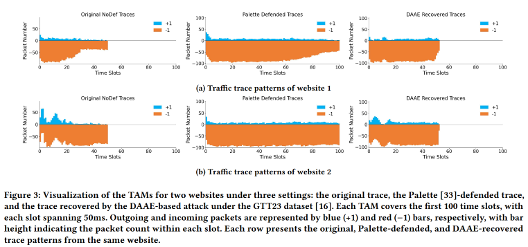

At test time, DAAE does not have access to the original trace. Instead, it maintains a small support pool constructed from the training set and applies the same inference pipeline to the captured defended traffic.
We designed two strategies to decode the defended packets into the original ones.
We find that directly thresholding at 0.5 for the predicted keep probabilities can incorrectly remove original packets or retain dummy packets, disrupting the original packet-direction subsequence. Therefore, we perform a sequence-level decoding step against support prototypes, where each prototype represents the packet-direction sequence of the packets labeled as original in a support trace. We introduce a skip bias to control the trade-off between retaining and removing packets and select the bias that produces a keep rate closest to the median keep rate of the support set. When multiple supports are available, we first consider supports whose kept-trace lengths are closest to the target length and select the candidate yielding the best sequence-level decoding score. The recovered trace is then constructed by retaining the captured packets selected by the final mask. Finally, we train a standard WF classifier, such as DF and RF, on the recovered traces and evaluate its classification performance to quantify how effectively DAAE restores the fingerprint information removed by the defense.

As shown in the third column of Figure 3, the recovered traces do not exactly match the originals, but much of their original traffic structure is restored. This result suggests that defense-induced traffic artifacts can be exploited to partially reverse the effect of traffic regularization, potentially undermining the defense against a sufficiently adaptive adversary. Figure 3 demonstrates that the original non-defended traces show distinct patterns in their Traffic Aggregation Matrices (TAMs). Palette aims to reduce this variability by regularizing traffic into a common pattern. However, the resulting defended traces can still preserve noticeable differences. More importantly, the regularization process introduces systematic dummy-packet injection patterns that may themselves become learnable by an adaptive adversary. 


### 4.4 Closed-world Evaluation

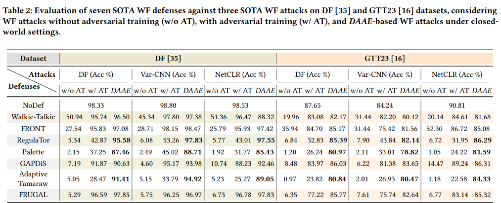

Table 2 presents a comprehensive comparison of the proposed DAAE-based WF attacks against conventional WF attacks trained with and without adversarial training (w/ AT and w/o AT, respectively). Without adversarial training (w/o AT), most defenses substantially reduce the classification accuracy of all three attacks, particularly on the DF dataset, where the accuracy of DF, Var-CNN, and NetCLR drops to 0.97–27.54% for most defenses. However, this apparent protection weakens considerably when the attacks are trained with adversarial training (w/ AT). For example, Walkie-Talkie, FRONT, and FRUGAL exhibit accuracies above 95% against all three attacks on the DF dataset, while GAPDiS also yields high accuracies ranging from 88.23% to 95.17%. These results suggest that evaluating defenses solely against conventionally trained attacks can substantially overestimate their robustness. The DAAE-based attacks further expose this limitation: their classification accuracy reaches 97.85% against FRUGAL and exceeds 95% against RegulaTor for all three classifiers on the DF dataset. Although some defenses, such as Palette and Adaptive Tamaraw, exhibit lower accuracy under adversarial training, their effectiveness remains dependent on the attack model, highlighting the importance of evaluating defenses under diverse attacker capabilities.
The results on GTT23 further reveal that defense effectiveness does not necessarily transfer across datasets. Compared with DF, the accuracy of conventionally trained attacks is generally higher against several defenses on GTT23; for example, FRONT yields accuracies of 35.94% and 52.30% against DF and NetCLR, respectively, while its corresponding accuracies on DF are 27.54% and 25.79%. Adversarial training also substantially improves attack performance against most defenses on GTT23, with accuracies reaching 89.24% for NetCLR against GAPDiS and 86.72% for NetCLR against FRONT. The DAAE-based attacks maintain high accuracy against several defenses, including GAPDiS, FRUGAL, and RegulaTor, although the results vary across classifiers. Notably, RegulaTor and Palette exhibit relatively low accuracy under adversarial training on both datasets, but their DAAE-based results show that this apparent robustness can be weakened by stronger attack strategies. Overall, these findings indicate that WF defense evaluations should account for both adversarially trained attackers and DAAE-based attacks, as well as differences between datasets, to provide a more comprehensive assessment of defense robustness.

### 4.5 Open-world Evaluation

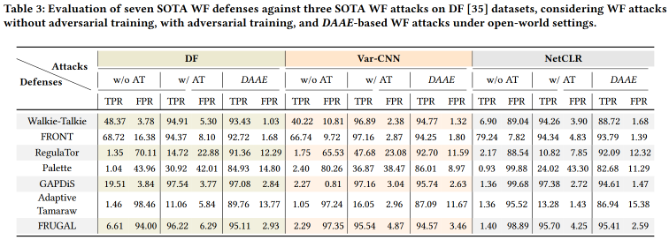

*Open-world evaluation under DF dataset*: The results in Table 3 show that the effectiveness of WF defenses varies considerably across attack models and training settings. Without adversarial training, most defenses exhibit limited resistance to WF attacks, although their performance differs across classifiers. For example, FRONT achieves relatively high TPRs of 68.72% and 66.74% against DF and Var-CNN, respectively, while maintaining moderate FPRs. In contrast, several defenses, including RegulaTor, Palette, Adaptive Tamaraw, and FRUGAL, exhibit substantially lower TPRs or high FPRs, indicating that their protection effectiveness is inconsistent. Adversarial training considerably improves attack performance across nearly all defenses, with TPRs frequently exceeding 90%. This suggests that adversarial training strengthens the robustness of WF classifiers against traffic perturbations introduced by these defenses. However, the results under DAAE-based attacks reveal that high detection rates largely persist even when defenses are evaluated under this setting: most defenses achieve TPRs above 82% across all three classifiers, with FPRs generally remaining below 16%. Notably, GAPDiS and FRONT achieve consistently high TPRs across the three classifiers, while Walkie-Talkie also exhibits strong detection performance, particularly under DF and Var-CNN. Overall, these findings indicate that existing SOTA defenses provide limited protection against advanced WF attacks in the open-world setting, and that adversarial training alone does not eliminate the vulnerability.

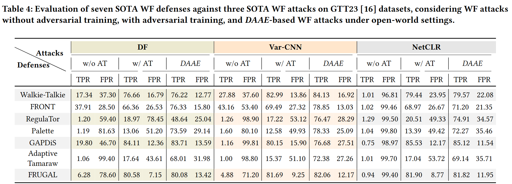

*Open-world evaluation under GTT23 dataset*: The results in Table 4 reveal that existing WF defenses provide limited protection against state-of-the-art WF attacks on the GTT23 dataset, particularly under the open-world setting. Without adversarial training, all seven defenses exhibit low TPRs across the three classifiers, with most values below 44%, while several defenses incur extremely high FPRs. For instance, RegulaTor, Palette, and Adaptive Tamaraw achieve TPRs close to 1% in multiple cases, indicating that they substantially impair attack detection but often at the cost of a high false-positive rate. Adversarial training improves detection performance considerably for most defenses, particularly GAPDiS and FRUGAL, which achieve TPRs of 84.11% and 80.58% against DF, 80.15% and 81.69% against Var-CNN, and 85.53% and 81.90% against NetCLR, respectively. However, these improvements are accompanied by varying FPRs, suggesting that adversarial training does not consistently provide a favorable balance between detection and false alarms. Under DAAE-based attacks, detection performance remains relatively high for several defenses, with GAPDiS achieving TPRs of 83.71%, 76.68%, and 85.12% across DF, Var-CNN, and NetCLR, respectively. FRUGAL also maintains competitive TPRs, ranging from 80.08% to 82.06%. In contrast, defenses such as RegulaTor, Palette, and Adaptive Tamaraw exhibit lower TPRs or substantially higher FPRs under this setting. Notably, NetCLR generally achieves the highest TPRs under adversarial training and DAAE-based attacks for GAPDiS and FRUGAL, whereas its performance without adversarial training remains extremely limited. Overall, these results demonstrate that the effectiveness of existing WF defenses is highly dependent on the attack model and training strategy, and that even under \D-based attacks, several defenses remain vulnerable to effective open-world classification.

### 4.6 A Comprehensive Comparison with the Chameleon Defense Method

Table 6: A comprehensive comparison of AT-resistant defenses against DAAE-based attacks on the GTT23 dataset.

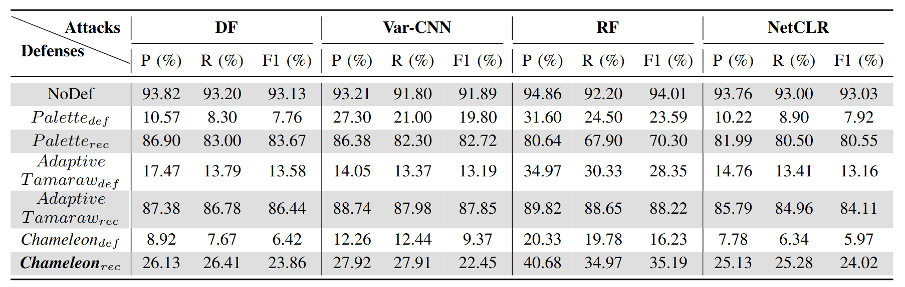

DAAE-based attack is designed for scenarios in which adversarial training-based WF cannot attack a defense. To evaluate the resistance of Chameleon to DAAE, we compare it with two SOTA defenses, Palette and Adaptive Tamaraw, which demonstrate strong resistance to adversarial training on the recent GTT23 dataset. We first use DAAE to reconstruct defended traces and then perform WF attacks using DF, Var-CNN, RF, and NetCLR implemented in the WFLib project to evaluate precision (P), recall (R), and F1-score (F1). Table 6 presents the performance of DAAE-based attacks against defenses that are resistant to adversarial training on the GTT23 dataset. Chameleon provides substantially stronger protection than the existing defenses, particularly when the attacker is trained on defended traffic. For the defense-trained setting $Chameleon_{def}$, Chameleon achieves F1-scores of 6.42%, 9.37%, 16.23%, and 5.97% against DF, Var-CNN, RF, and NetCLR, respectively. These results are consistently lower than those of $Palette_{def}$ and $Adaptive~Tamaraw_{def}$, demonstrating that Chameleon is robust and efficient in defending against adversarial training-based attacks.

After performing the DAAE-based WF attacks, the results further highlight the robustness of Chameleon. Under $Chameleon_{rec}$, the F1-score of the DAAE-based DF attack only increases from 6.42% to 23.86%, while the same attack increases from 7.76% to 83.67% under the $Palette_{rec}$ defense. In particular, $Chameleon_{rec}$ limits the strongest attack, RF, to an F1-score of only 35.19%, while the corresponding scores for $Palette_{rec}$ and $Adaptive~Tamaraw_{rec}$ reach 70.30% and 88.22%, respectively. These results indicate that Chameleon remains robust and effective even when the attacker can reconstruct or retrain on defended traffic, confirming that its randomized morphing strategy provides stronger resistance to defense-aware attacks.


### 4.7 Ablation Study

In this section, we conduct an ablation study to evaluate the effectiveness of the proposed DAAE. As shown in Section 4.4, among the evaluated defense mechanisms, only Regulator, Palette, and Adaptive Tamaraw demonstrate effectiveness and robustness against AT-based attacks. Therefore, we focus our ablation study on these three defenses to provide a more meaningful and precise evaluation of DAAE. For the remaining defenses, the performance differences between AT-based attacks and DAAE-based attacks are relatively small, making them less informative for assessing the contribution of individual components of DAAE.

#### 4.7.1 LCS with and without Burst Feature Specification

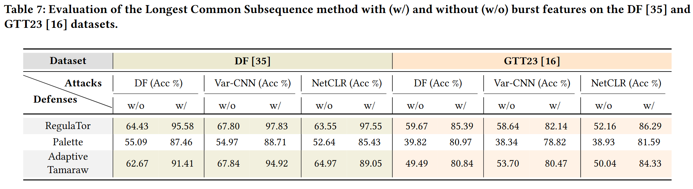

In the design of the DAAE, we investigate two LCS-based strategies for learning the relationship between original and defended traffic: (1) applying LCS directly to the entire packet sequence and (2) incorporating burst-level features into the LCS matching process. The former captures similarities at the packet level, whereas the latter additionally exploits burst-level traffic patterns to improve the alignment between original and defended traces. We evaluate both strategies using three WF classifiers (DF, Var-CNN, and NetCLR) on two datasets (DF and GTT23) against three representative defenses. The results are reported in Table 7.

Overall, incorporating burst features substantially improves attack performance across all evaluated datasets, defenses, and classifiers. On the DF dataset, the accuracy improvements range from 24.08 to 34.00 percentage points. In particular, against RegulaTor, adding burst features increases the accuracy of DF, Var-CNN, and NetCLR from 64.43%, 67.80%, and 63.55% to 95.58%, 97.83%, and 97.55%, respectively. Similar improvements are observed against Adaptive Tamaraw, with gains ranging from 24.08 to 28.62 percentage points. These results indicate that burst-level information provides useful structural cues for identifying the correspondence between original and defended traffic.

The improvements are also consistent on the more challenging GTT23 dataset. Across the three defenses and classifiers, incorporating burst features yields accuracy gains ranging from 23.50 to 42.66 percentage points. For example, against Palette, the accuracy of DF increases from 39.82% to 80.97%, while Var-CNN and NetCLR improve from 38.34% and 38.93% to 78.82% and 81.59%, respectively. Notably, burst features also provide substantial gains against RegulaTor and Adaptive Tamaraw, despite the relatively higher accuracy achieved by the baseline LCS approach in some settings.

These results demonstrate that applying LCS solely to packet sequences is insufficient to capture the structural correspondence between original and defended traffic fully. Burst features provide complementary information about packet grouping and transmission patterns, enabling more effective sequence alignment under defense-induced traffic transformations. Consequently, we adopt the burst-feature-enhanced LCS strategy in DAAE for subsequent evaluations.

#### 4.7.2 Dataset Selection Ratio Evaluation

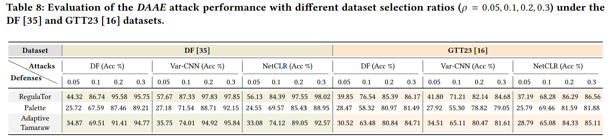

In practical scenarios, collecting paired original and defended traffic traces is time-consuming and costly for an adversary. Although increasing the training dataset size can improve DAAE's ability to learn defense-induced traffic transformations, it also introduces additional data collection, memory, and training costs. Therefore, selecting an appropriate dataset ratio is important for balancing attack effectiveness and resource consumption.

To investigate this trade-off, we evaluate four dataset selection ratios (0.05, 0.1, 0.2, and 0.3) across three WF classifiers (DF, Var-CNN, and NetCLR), three defenses (RegulaTor, Palette, and Adaptive Tamaraw), and two datasets (DF and GTT23). As shown in Table 8, increasing the selection ratio consistently improves attack accuracy across the evaluated settings. For example, under RegulaTor on DF, the accuracy of DF increases from 44.32% at a ratio of 0.05 to 95.58% at 0.2. Similar improvements are observed with Var-CNN and NetCLR, reaching 97.83% and 97.55%, respectively. Averaged across all defense-classifier combinations, the accuracy increases from 43.81% to 91.99% on DF and from 32.76% to 82.32% on GTT23 when the ratio increases from 0.05 to 0.2. These results demonstrate the importance of sufficient paired training data for learning defense-induced traffic transformations.

However, the benefits become considerably smaller when increasing the ratio from 0.2 to 0.3. The average accuracy improves by only 1.91 percentage points on DF and 1.16 percentage points on GTT23. Although some individual settings achieve slightly larger gains, such as 3.87 percentage points against Adaptive Tamaraw with DF on GTT23, most improvements remain relatively limited. In contrast, increasing the selection ratio from 0.2 to 0.3 requires collecting more training traces, resulting in additional memory consumption and training overhead. Therefore, we select 0.2 as the default dataset selection ratio, as it provides a favorable trade-off between attack effectiveness and resource consumption.

#### 4.7.3 Impact of the Support Bank

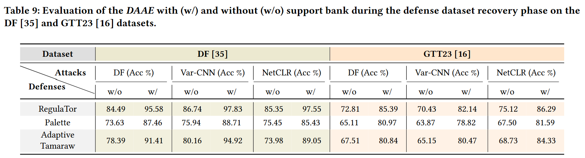

To investigate the contribution of the support bank, we evaluate FS-DAAE with and without support bank assistance during the defense dataset recovery phase. The support bank stores LCS-extracted dummy packet injection positions for different traffic features, providing additional information to identify and remove likely dummy packets from defended traces. As shown in Table 9, enabling the support bank consistently improves attack accuracy across all evaluated defenses, classifiers, and datasets. Specifically, the average accuracy increases from 79.35% to 92.44% on DF and from 67.35% to 82.23% on GTT23, representing improvements of 13.09 and 14.88 percentage points, respectively.

The improvements are consistent across different defenses and classifiers. For example, against RegulaTor on DF, DF and Var-CNN accuracy increase from 84.49% and 86.74% to 95.58% and 97.83%, respectively. Similar improvements are observed against Palette and Adaptive Tamaraw on both datasets. These results demonstrate that the support bank provides valuable information for identifying defense-induced dummy packet positions, enabling FS-DAAE to recover more informative traffic patterns and improve subsequent WF classification. Overall, the support bank is an important component of DAAE, contributing consistently to its effectiveness across different defenses and traffic collection settings.

#### 4.7.4 Impact of the Focal Loss Function

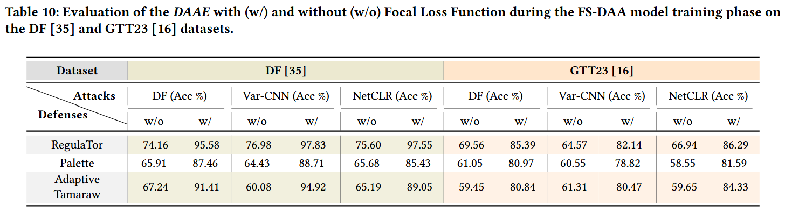

During the training phase of DAAE, we employ the Focal Loss function to calculate the training loss. To evaluate its effectiveness, we compare the performance of DAAE with and without Focal Loss across three WF classifiers (DF, Var-CNN, and NetCLR), three representative defenses, and two datasets (DF and GTT23). The results are presented in Table 10.

Overall, incorporating Focal Loss consistently improves attack accuracy across all evaluated settings. On the DF dataset, the accuracy gains range from 19.75 to 34.84 percentage points. In particular, under Adaptive Tamaraw, the accuracy of Var-CNN increases from 60.08% to 94.92%, representing a gain of 34.84 percentage points. Averaged across all defense-classifier combinations, incorporating Focal Loss increases accuracy from 68.36% to 91.99%, an improvement of 23.63 percentage points.

Similar improvements are observed on the GTT23 dataset, where accuracy increases by 15.83 to 24.68 percentage points across the evaluated settings. For example, against Adaptive Tamaraw, NetCLR accuracy improves from 59.65% to 84.33%. On average, Focal Loss increases accuracy from 62.40% to 82.32%, corresponding to a gain of 19.91 percentage points.

These results demonstrate that Focal Loss plays an important role in improving DAAE's ability to learn defense-induced traffic transformations. By emphasizing difficult training examples, it helps the model learn more discriminative representations of the transformations introduced by different defenses. Consequently, we adopt Focal Loss in the subsequent DAAE evaluations.

## References

[1] Khaled Al-Naami, Amir El-Ghamry, Md Shihabul Islam, Latifur Khan, Bhavani Thuraisingham, Kevin W. Hamlen, Mohammed F. Alrahmawy, and Magdi Zakria Rashad. 2021. BiMorphing: A Bi-Directional Bursting Defense against Website Fingerprinting Attacks. IEEE Trans. Dependable Secur. Comput. 18, 2 (2021), 505–517. doi:10.1109/TDSC.2019.2907240

[2] Alireza Bahramali, Ardavan Bozorgi, and Amir Houmansadr. 2023. Realistic Website Fingerprinting By Augmenting Network Traces. In Proceedings of the 2023 ACM SIGSAC Conference on Computer and Communications Security, CCS 2023, November 26-30, 2023, Weizhi Meng, Christian Damsgaard Jensen, Cas Cremers, and Engin Kirda (Eds.). ACM, Copenhagen, Denmark, 1035–1049. doi:10.1145/3576915.3616639

[3] Sanjit Bhat, David Lu, Albert Kwon, and Srinivas Devadas. 2019. Var-CNN: A Data-Efficient Website Fingerprinting Attack Based on Deep Learning. Proc. Priv. Enhancing Technol. 2019, 4 (2019), 292–310. doi:10.2478/POPETS-2019-0070

[4] Xiang Cai, Rishab Nithyanand, Tao Wang, Rob Johnson, and Ian Goldberg. 2014. A Systematic Approach to Developing and Evaluating Website Fingerprinting Defenses. In Proceedings of the 2014 ACM SIGSAC Conference on Computer and Communications Security, November 3-7, 2014, Gail-Joon Ahn, Moti Yung, and Ninghui Li (Eds.). ACM, Scottsdale, AZ, USA, 227–238. doi:10.1145/2660267.2660362

[5] Eric Chan-Tin, Taejoon Kim, and Jinoh Kim. 2018. Website Fingerprinting Attack Mitigation Using Traffic Morphing. In 38th IEEE International Conference on Distributed Computing Systems, ICDCS 2018, July 2-6, 2018. IEEE Computer Society, Vienna, Austria, 1575–1578. doi:10.1109/ICDCS.2018.00174

[6] Xinhao Deng, Qilei Yin, Zhuotao Liu, Xiyuan Zhao, Qi Li, Mingwei Xu, Ke Xu, and Jianping Wu. 2023. Robust Multi-tab Website Fingerprinting Attacks in the Wild. In 44th IEEE Symposium on Security and Privacy, SP 2023, May 21-25, 2023. IEEE, San Francisco, CA, USA, 1005–1022. doi:10.1109/SP46215.2023.10179464

[7] Xinhao Deng, Yixiang Zhang, Qi Li, Zhuotao Liu, Yabo Wang, and Ke Xu. 2026. Enhancing Website Fingerprinting Attacks against Traffic Drift. In 33rd Annual Network and Distributed System Security Symposium, NDSS 2026, February 23-27, 2026. The Internet Society, San Diego, California, USA, 1–18. [https://www.ndss-symposium.org/ndss-paper/enhancing-website-fingerprinting-attacks-against-traffic-drift/](https://www.ndss-symposium.org/ndss-paper/enhancing-website-fingerprinting-attacks-against-traffic-drift/)

[8] Xianwen Deng, Ruijie Zhao, Yanhao Wang, Mingwei Zhan, Zhi Xue, and Yijun Wang. 2025. Countmamba: A Generalized Website Fingerprinting Attack via Coarse-Grained Representation and Fine-Grained Prediction. In IEEE Symposium on Security and Privacy, SP 2025, May 12-15, 2025, Marina Blanton, William Enck, and Cristina Nita-Rotaru (Eds.). IEEE, San Francisco, CA, USA, 1419–1437. doi:10.1109/SP61157.2025.00154

[9] Kevin P. Dyer, Scott E. Coull, Thomas Ristenpart, and Thomas Shrimpton. 2012. Peek-a-Boo, I Still See You: Why Efficient Traffic Analysis Countermeasures Fail. In IEEE Symposium on Security and Privacy, SP 2012, 21-23 May 2012. IEEE Computer Society, San Francisco, California, USA, 332–346. doi:10.1109/SP.2012.28

[10] David Goldschlag, Michael Reed, and Paul Syverson. 1999. Onion routing. Commun. ACM 42, 2 (1999), 39–41.

[11] Jiajun Gong and Tao Wang. 2020. Zero-delay Lightweight Defenses against Website Fingerprinting. In 29th USENIX Security Symposium, USENIX Security 2020, August 12-14, 2020, Srdjan Capkun and Franziska Roesner (Eds.). USENIX Association, Boston, MA, USA, 717–734. [https://www.usenix.org/conference/usenixsecurity20/presentation/gong](https://www.usenix.org/conference/usenixsecurity20/presentation/gong)

[12] Jiajun Gong, Wuqi Zhang, Charles Zhang, and Tao Wang. 2024. WFDefProxy: Real World Implementation and Evaluation of Website Fingerprinting Defenses. IEEE Trans. Inf. Forensics Secur. 19 (2024), 1357–1371. doi:10.1109/TIFS.2023.3327662

[13] James K. Holland and Nicholas Hopper. 2022. RegulaTor: A Straightforward Website Fingerprinting Defense. Proc. Priv. Enhancing Technol. 2022, 2 (2022), 344–362. doi:10.2478/POPETS-2022-0049

[14] Chengshang Hou, Junzheng Shi, Mingxin Cui, Mengyan Liu, and Jing Yu. 2021. Universal Website Fingerprinting Defense Based on Adversarial Examples. In 20th IEEE International Conference on Trust, Security and Privacy in Computing and Communications, TrustCom 2021, October 20-22, 2021. IEEE, Shenyang, China, 99–106. doi:10.1109/TRUSTCOM53373.2021.00031

[15] Rob Jansen. 2026. CELLSHIFT: RTT-Aware Trace Transduction for Real-World Website Fingerprinting. In 33rd Annual Network and Distributed System Security Symposium, NDSS 2026, February 23-27, 2026. The Internet Society, San Diego, California, USA, 1–18. [https://www.ndss-symposium.org/ndss-paper/cellshift-rtt-aware-trace-transduction-for-real-world-website-fingerprinting/](https://www.ndss-symposium.org/ndss-paper/cellshift-rtt-aware-trace-transduction-for-real-world-website-fingerprinting/)

[16] Rob Jansen, Ryan Wails, and Aaron Johnson. 2026. A Measurement of Genuine Tor Traces for Realistic Website Fingerprinting. In Passive and Active Measurement - 27th International Conference, PAM 2026, March 23-25, 2026, Proceedings (Lecture Notes in Computer Science, Vol. 16477), Simone Ferlin-Reiter, Romain Fontugne, and Johanna Ullrich (Eds.). Springer, Virtual Event, 277–293. doi:10.1007/978-3-032-18268-5_13

[17] Marc Juarez, Sadia Afroz, Gunes Acar, Claudia Díaz, and Rachel Greenstadt. 2014. A Critical Evaluation of Website Fingerprinting Attacks. In Proceedings of the 2014 ACM SIGSAC Conference on Computer and Communications Security, November 3-7, 2014, Gail-Joon Ahn, Moti Yung, and Ninghui Li (Eds.). ACM, Scottsdale, AZ, USA, 263–274. doi:10.1145/2660267.2660368

[18] Marc Juarez, Mohsen Imani, Mike Perry, Claudia Díaz, and Matthew Wright. 2016. Toward an Efficient Website Fingerprinting Defense. In Computer Security ESORICS 2016 - 21st European Symposium on Research in Computer Security, September 26-30, 2016, Proceedings, Part I (Lecture Notes in Computer Science, Vol. 9878), Ioannis G. Askoxylakis, Sotiris Ioannidis, Sokratis K. Katsikas, and Catherine Meadows (Eds.). Springer, Heraklion, Greece, 27–46. doi:10.1007/978-3-319-45744-4_2

[19] Khashayar Khajavi and Tao Wang. 2026. Lightening the Load: A Cluster-Based Framework for A Lower-Overhead, Provable Website Fingerprinting Defense. In 33rd Annual Network and Distributed System Security Symposium, NDSS 2026, February 23-27, 2026. The Internet Society, San Diego, California, USA, 1–18. [https://www.ndss-symposium.org/ndss-paper/lightening-the-load-a-cluster-based-framework-for-a-lower-overhead-provable-website-fingerprinting-defense/](https://www.ndss-symposium.org/ndss-paper/lightening-the-load-a-cluster-based-framework-for-a-lower-overhead-provable-website-fingerprinting-defense/)

[20] Albert Kwon, Mashael AlSabah, David Lazar, Marc Dacier, and Srinivas Devadas. 2015. Circuit Fingerprinting Attacks: Passive Deanonymization of Tor Hidden Services. In 24th USENIX Security Symposium, USENIX Security 15, August 12-14, 2015, Jaeyeon Jung and Thorsten Holz (Eds.). USENIX Association, Washington, D.C., USA, 287–302. [https://www.usenix.org/conference/usenixsecurity15/technical-sessions/presentation/kwon](https://www.usenix.org/conference/usenixsecurity15/technical-sessions/presentation/kwon)

[21] Ding Li, Yuefei Zhu, Minghao Chen, and Jue Wang. 2022. Minipatch: Undermining DNN-Based Website Fingerprinting With Adversarial Patches. IEEE Trans. Inf. Forensics Secur. 17 (2022), 2437–2451. doi:10.1109/TIFS.2022.3186743

[22] Zhen Ling, Gui Xiao, Lan Luo, Rong Wang, Xiangyu Xu, and Guangchi Liu. 2024. WFGuard: an Effective Fuzzing-testing-based Traffic Morphing Defense against Website Fingerprinting. In IEEE INFOCOM 2024 - IEEE Conference on Computer Communications, May 20-23, 2024. IEEE, Vancouver, BC, Canada, 441–450. doi:10.1109/INFOCOM52122.2024.10621121

[23] Ling Liu, Ning Hu, Chun Shan, Yu Jiang, and Xin Liu. 2023. SMART: A lightweight and reliable multi-path transmission model against website fingerprinting attacks. Electronics 12, 7 (2023), 1668.

[24] Nate Mathews, James K. Holland, Nicholas Hopper, and Matthew Wright. 2024. Laserbeak: Evolving Website Fingerprinting Attacks With Attention and Multi-Channel Feature Representation. IEEE Trans. Inf. Forensics Secur. 19 (2024), 9285–9300. doi:10.1109/TIFS.2024.3468171

[25] Nate Mathews, James K. Holland, Se Eun Oh, Mohammad Saidur Rahman, Nicholas Hopper, and Matthew Wright. 2023. SoK: A Critical Evaluation of Efficient Website Fingerprinting Defenses. In 44th IEEE Symposium on Security and Privacy, SP 2023, May 21-25, 2023. IEEE, San Francisco, CA, USA, 969–986. doi:10.1109/SP46215.2023.10179289

[26] Se Eun Oh, Nate Mathews, Mohammad Saidur Rahman, Matthew Wright, and Nicholas Hopper. 2021. GANDALF: GAN for Data-Limited Fingerprinting. Proc. Priv. Enhancing Technol. 2021, 2 (2021), 305–322. doi:10.2478/POPETS-2021-0029

[27] Andriy Panchenko, Lukas Niessen, Andreas Zinnen, and Thomas Engel. 2011. Website fingerprinting in onion routing based anonymization networks. In Proceedings of the 10th annual ACM workshop on Privacy in the electronic society, WPES 2011, October 17, 2011, Yan Chen and Jaideep Vaidya (Eds.). ACM, Chicago, IL, USA, 103–114. doi:10.1145/2046556.2046570

[28] Litao Qiao, Bang Wu, Heng Li, Cuiying Gao, Wei Yuan, and Xiapu Luo. 2024. Trace-agnostic and Adversarial Training-resilient Website Fingerprinting Defense. In IEEE INFOCOM 2024 IEEE Conference on Computer Communications, May 20-23, 2024. IEEE, Vancouver, BC, Canada, 211–220. doi:10.1109/INFOCOM52122.2024.10621205

[29] Mohammad Saidur Rahman, Mohsen Imani, Nate Mathews, and Matthew Wright. 2021. Mockingbird: Defending Against Deep-Learning-Based Website Fingerprinting Attacks With Adversarial Traces. IEEE Trans. Inf. Forensics Secur. 16 (2021), 1594–1609. doi:10.1109/TIFS.2020.3039691

[30] Mohammad Saidur Rahman, Payap Sirinam, Nate Mathews, Kantha Girish Gangadhara, and Matthew Wright. 2020. Tik-Tok: The Utility of Packet Timing in Website Fingerprinting Attacks. Proc. Priv. Enhancing Technol. 2020, 3 (2020), 5–24. doi:10.2478/POPETS-2020-0043

[31] Vera Rimmer, Davy Preuveneers, Marc Juarez, Tom van Goethem, and Wouter Joosen. 2018. Automated Website Fingerprinting through Deep Learning. In 25th Annual Network and Distributed System Security Symposium, NDSS 2018, February 18-21, 2018. The Internet Society, San Diego, California, USA, 1–15. [https://www.ndss-symposium.org/wp-content/uploads/2018/02/ndss2018_03A-1_Rimmer_paper.pdf](https://www.ndss-symposium.org/wp-content/uploads/2018/02/ndss2018_03A-1_Rimmer_paper.pdf)

[32] Meng Shen, Kexin Ji, Zhenbo Gao, Qi Li, Liehuang Zhu, and Ke Xu. 2023. Subverting Website Fingerprinting Defenses with Robust Traffic Representation. In 32nd USENIX Security Symposium, USENIX Security 2023, August 9-11, 2023, Joseph A. Calandrino and Carmela Troncoso (Eds.). USENIX Association, Anaheim, CA, USA, 607–624. [https://www.usenix.org/conference/usenixsecurity23/presentation/shen-meng](https://www.usenix.org/conference/usenixsecurity23/presentation/shen-meng)

[33] Meng Shen, Kexin Ji, Jinhe Wu, Qi Li, Xiangdong Kong, Ke Xu, and Liehuang Zhu. 2024. Real-Time Website Fingerprinting Defense via Traffic Cluster Anonymization. In IEEE Symposium on Security and Privacy, SP 2024, May 19-23, 2024. IEEE, San Francisco, CA, USA, 3238–3256. doi:10.1109/SP54263.2024.00247

[34] Meng Shen, Jinhe Wu, Junyu Ai, Qi Li, Chenchen Ren, Ke Xu, and Liehuang Zhu. 2025. Swallow: A Transfer-Robust Website Fingerprinting Attack via Consistent Feature Learning. In Proceedings of the 2025 ACM SIGSAC Conference on Computer and Communications Security, CCS 2025, October 13-17, 2025, Chun-Ying Huang, Jyh-Cheng Chen, Shiuh-Pyng Shieh, David Lie, and Véronique Cortier (Eds.). ACM, Taipei, Taiwan, 1574–1588. doi:10.1145/3719027.3744795

[35] Payap Sirinam, Mohsen Imani, Marc Juarez, and Matthew Wright. 2018. Deep Fingerprinting: Undermining Website Fingerprinting Defenses with Deep Learning. In Proceedings of the 2018 ACM SIGSAC Conference on Computer and Communications Security, CCS 2018, October 15-19, 2018, David Lie, Mohammad Mannan, Michael Backes, and XiaoFeng Wang (Eds.). ACM, Toronto, ON, Canada, 1928–1943. doi:10.1145/3243734.3243768

[36] Boyu Sun, Wenyuan Yang, Mengqi Yan, Yuesheng Zhu, and Zhiqiang Bai. 2022. A Practical Website Fingerprinting Defense Approach with Universal Adversarial Perturbations. In 7th International Conference on Computer and Communication Systems, ICCCS 2022, April 22-25, 2022. IEEE, Wuhan, China, 752–760. doi:10.1109/ICCCS55155.2022.9846237

[37] The Tor Project. 2026. Research Safety Board. [https://research.torproject.org/safetyboard/](https://research.torproject.org/safetyboard/). Accessed: 2026-08-19.

[38] Tor Project. 2022. Pluggable Transport Specification (Version 1). [https://spec.torproject.org/pt-spec](https://spec.torproject.org/pt-spec). Tor Specifications.

[39] Rong Wang, Zhen Ling, Guangchi Liu, Shaofeng Li, Junzhou Luo, and Xinwen Fu. 2026. Cease at the Ultimate Goodness: Towards Efficient Website Fingerprinting Defense via Iterative Mutual Information Minimization. In 33rd Annual Network and Distributed System Security Symposium, NDSS 2026, February 23-27, 2026. The Internet Society, San Diego, California, USA, 1–20. [https://www.ndss-symposium.org/ndss-paper/cease-at-the-ultimate-goodness-towards-efficient-website-fingerprinting-defense-via-iterative-mutual-information-minimization/](https://www.ndss-symposium.org/ndss-paper/cease-at-the-ultimate-goodness-towards-efficient-website-fingerprinting-defense-via-iterative-mutual-information-minimization/)

[40] Tao Wang, Xiang Cai, Rishab Nithyanand, Rob Johnson, and Ian Goldberg. 2014. Effective Attacks and Provable Defenses for Website Fingerprinting. In Proceedings of the 23rd USENIX Security Symposium, August 20-22, 2014, Kevin Fu and Jaeyeon Jung (Eds.). USENIX Association, San Diego, CA, USA, 143–157. [https://www.usenix.org/conference/usenixsecurity14/technical-sessions/presentation/wang_tao](https://www.usenix.org/conference/usenixsecurity14/technical-sessions/presentation/wang_tao)

[41] Tao Wang and Ian Goldberg. 2013. Improved website fingerprinting on Tor. In Proceedings of the 12th annual ACM Workshop on Privacy in the Electronic Society, WPES 2013, November 4, 2013, Ahmad-Reza Sadeghi and Sara Foresti (Eds.). ACM, Berlin, Germany, 201–212. doi:10.1145/2517840.2517851

[42] Tao Wang and Ian Goldberg. 2016. On Realistically Attacking Tor with Website Fingerprinting. Proc. Priv. Enhancing Technol. 2016, 4 (2016), 21–36. doi:10.1515/POPETS-2016-0027

[43] Tao Wang and Ian Goldberg. 2017. Walkie-Talkie: An Efficient Defense Against Passive Website Fingerprinting Attacks. In 26th USENIX Security Symposium, USENIX Security 2017, August 16-18, 2017, Engin Kirda and Thomas Ristenpart (Eds.). USENIX Association, Vancouver, BC, Canada, 1375–1390. [https://www.usenix.org/conference/usenixsecurity17/technical-sessions/presentation/wang-tao](https://www.usenix.org/conference/usenixsecurity17/technical-sessions/presentation/wang-tao)

[44] Ruotian Xie, Kun Xie, Pengcheng Zhao, Jiajun He, Xin Zeng, Jigang Wen, Yong Xie, Wei Liang, and Gaogang Xie. 2025. GAPDIS: Gradient-Assisted Perturbation Design via Sequence Editing for Website Fingerprinting Defense. In Proceedings of the 2025 ACM SIGSAC Conference on Computer and Communications Security, CCS 2025, October 13-17, 2025, Chun-Ying Huang, Jyh-Cheng Chen, Shiuh-Pyng Shieh, David Lie, and Véronique Cortier (Eds.). ACM, Taipei, Taiwan, 3012–3026. doi:10.1145/3719027.3765084

[45] Xiyuan Zhao, Xinhao Deng, Qi Li, Yunpeng Liu, Zhuotao Liu, Kun Sun, and Ke Xu. 2024. Towards Fine-Grained Webpage Fingerprinting at Scale. In Proceedings of the 2024 on ACM SIGSAC Conference on Computer and Communications Security, CCS 2024, October 14-18, 2024, Bo Luo, Xiaojing Liao, Jun Xu, Engin Kirda, and David Lie (Eds.). ACM, Salt Lake City, UT, USA, 423–436. doi:10.1109/SP61157.2025.00154

[46] Qiang Zhou, Liangmin Wang, Huijuan Zhu, Tong Lu, and Victor S. Sheng. 2024. WF-Transformer: Learning Temporal Features for Accurate Anonymous Traffic Identification by Using Transformer Networks. IEEE Trans. Inf. Forensics Secur. 19 (2024), 30–43. doi:10.1109/TIFS.2023.3318966

